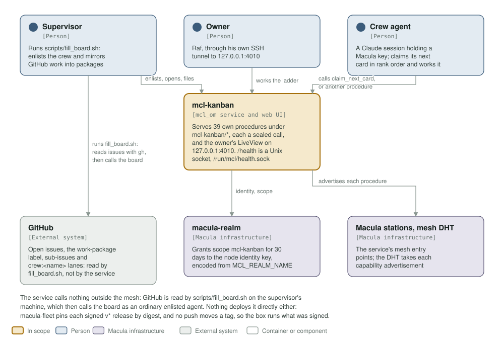
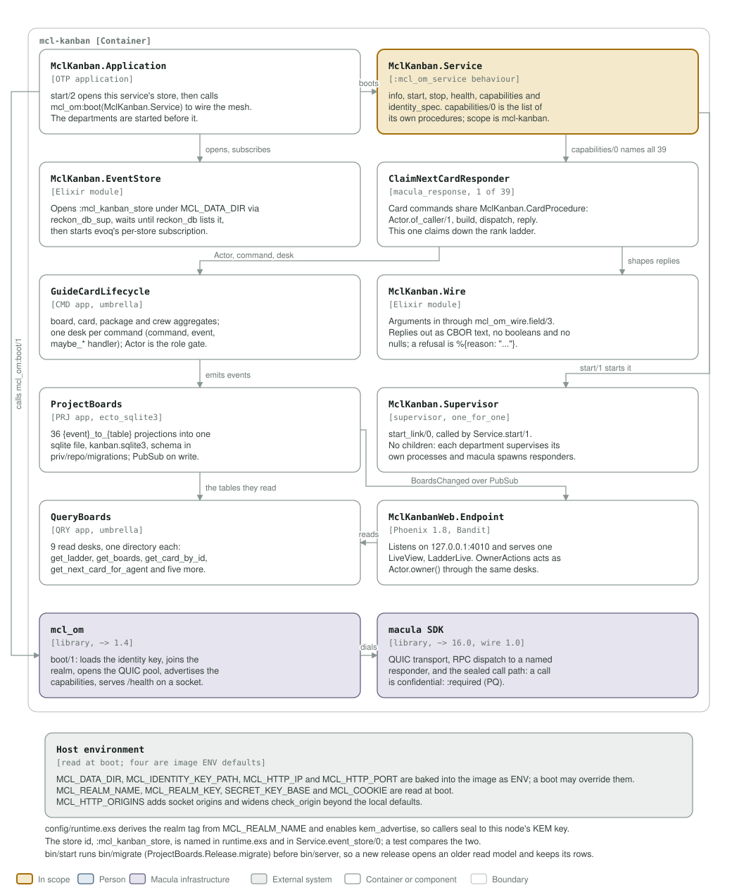

# mcl-kanban architecture: C4 model

*This exists so a reader can see what mcl-kanban talks to, and what it is made of,
without reading it.*

**Status: live on the mesh, one box, one board per repo.** The service opens its own
reckon-db store and the sqlite read model, advertises 39 sealed procedures of its own and serves
the owner's one LiveView on `:4010` -- loopback by default, and on the LAN where the
box sets `MCL_HTTP_IP=0.0.0.0`. It calls nothing outside the mesh, and it
publishes no topics. It subscribes to the realm's five crew facts, one topic
each, and once a minute calls the realm's `identity/crew_standing_v1` for every
crew it knows (#40); both are off while `MCL_REALM_KEY` is unset.

## Level 1: system context

| Element | Kind | Role |
| --- | --- | --- |
| mcl-kanban | In scope | Serves 39 procedures of its own under `mcl-kanban/*`, each a confidential call, and the owner's LiveView on `:4010`: the image defaults to `127.0.0.1`, and the box that runs it serves the LAN (`macula-fleet` `edge/scripts/docker-compose.mcl-kanban.yml`:54-56). `/health` is a Unix socket, `/run/mcl/health.sock` |
| Supervisor | Person | Runs `scripts/fill_board.sh`, which reads GitHub issues, labels and sub-issues with `gh` and then calls the board as an ordinary agent |
| Owner | Person | Raf, at the board's UI on `:4010` on the box's LAN address, no login |
| Crew agent | Person | A Claude session holding a Macula key: calls `claim_next_card`, works the card, calls the next procedure |
| GitHub | External system | Open issues, the `work-package` label, sub-issues and `crew:<name>` lanes. Read by `fill_board.sh`, never by the service |
| macula-realm | Macula infrastructure | Grants the node scope `mcl-kanban` for 30 days, against the identity key and the realm tag derived from `MCL_REALM_NAME` |
| Macula stations, mesh DHT | Macula infrastructure | The service's mesh entry points; the DHT holds an advertisement for each of its own procedures |

The service calls nothing outside the mesh. GitHub is read on the supervisor's
machine, by `scripts/fill_board.sh`, which then calls the board as an ordinary
enlisted agent. Nothing deploys the service directly either: `macula-fleet` pins each
signed `v*` release by digest (`edge/gitops/release-targets`:99-100), and a push to
`main` publishes `:main` and `:<sha>` while nothing moves `:latest`.

## Level 2: containers and components

| Component | Technology | Responsibility |
| --- | --- | --- |
| `MclKanban.Application` | OTP application | `start/2` opens this service's store, then calls `mcl_om:boot(MclKanban.Service)`. The departments start before it, so their projections are registered when the subscription delivers |
| `MclKanban.Service` | the `:mcl_om_service` behaviour | `info/0`, `start/1`, `stop/1`, `health/0`, `capabilities/0`, `identity_spec/0`, `subscriptions/0` (the realm's crew-fact topics, and none while no realm key is set). The `mcl-kanban/*` names are its own procedures and `capabilities/0` is the list of them; `mcl-om` adds `mcl-kanban/info` and `mcl-kanban/get_limits` to every service, both open. `identity_spec/0` asks for scope `mcl-kanban`, 30 days, no actions and no resources |
| `MclKanban.EventStore` | Elixir module | Opens `:mcl_kanban_store` under `MCL_DATA_DIR` through `reckon_db_sup`, waits until `reckon_db` lists it, then starts `evoq`'s per-store subscription. The id is named here, in `Service.event_store/0` and in `config/runtime.exs`, and a test compares them |
| `ClaimNextCardResponder` | `macula_response`, one of its 39 | The card commands share `MclKanban.CardProcedure`: `Actor.of_caller/1`, build, dispatch, reply. `claim_next_card` claims down the rank ladder, skipping a card another agent took in between |
| `MclKanban.Wire` | Elixir module | Arguments in through `mcl_om_wire.field/3`; replies out as CBOR text with no booleans and no nulls, so a refusal is `%{reason: "already_claimed"}` and an agent reads it as plain text |
| `GuideCardLifecycle` | CMD app, umbrella | The `board`, `card`, `package` and `crew` aggregates, one desk per command (command, event, `maybe_*` handler), and `Actor` as the role gate. Status is bit flags |
| `GuideCardLifecycle.CrewFacts` | `macula_subscriber` + one PM per fact | The realm's crew facts: read the shape, verify the ML-DSA signature against the pinned `MCL_REALM_KEY`, keep the highest `seq` per crew id (`crew_fact_observed_v1`), then act as `Actor.realm()` through `on_crew_admitted_appoint_operator`, `on_crew_operator_replaced_appoint_operator` or one of the three drop PMs. One fact is believed at a time (`CrewFactGate`), so the seq rule and its act are one step; a fact's name comes from its topic, never from the payload; a fact whose crew id does not match the name the board holds is refused by name, as is one naming a crew the board's own crews answer to (the home crew, or one made by hand); and each appoint PM discharges every agent of the crew the fact no longer names. The role gate refuses the realm's name to agents, refuses it any board-order role, and only `CrewFacts` ever builds that actor |
| `CrewStandingReconciler` | GenServer, one tick a minute | The board's revocation bound (#40): asks `identity/crew_standing_v1` for every crew the board knows at start and every 60 s, and puts the answer -- the realm's latest signed fact -- through the same verifier and seq rule. An error, a lost answer or `unknown_crew` changes nothing; only a signed fact ends a crew |
| `ProjectBoards` | PRJ app, `ecto_sqlite3` | 36 `{event}_to_{table}` projections into one sqlite file, `kanban.sqlite3`, schema in `priv/repo/migrations`. Each write is announced on `MclKanbanWeb.PubSub` as `BoardsChanged` |
| `QueryBoards` | QRY app, umbrella | 9 read desks, one directory each: `get_ladder`, `get_boards`, `get_board_by_repo`, `get_card_by_id`, `get_cards_by_holder`, `get_crew`, `get_goal`, `get_next_card_for_agent`, `get_ranked_cards` |
| `MclKanban.Supervisor` | supervisor, `one_for_one` | `start_link/0`, called by `Service.start/1`. One child, `CrewStandingReconciler`; everything else supervises itself and macula spawns a process per call |
| `MclKanbanWeb.Endpoint` | Phoenix 1.8, Bandit | Listens on `127.0.0.1:4010` by default; the box sets `MCL_HTTP_IP=0.0.0.0`, so it also serves the LAN at `:4010`, with no login. Serves one LiveView, `LadderLive`; `OwnerActions` acts as `Actor.owner()` through the same desks the mesh uses |
| `mcl_om` | library, `~> 1.4` | `boot/1`: loads the identity key, joins the realm, opens the QUIC pool through the stations, advertises the declared capabilities, serves `/health` on a Unix socket |
| macula SDK | library, `~> 16.0`, wire 1.0 | QUIC transport, RPC dispatch to a responder that answers by name, and the sealed call path: its own calls are `confidential: :required`, so one in the clear is refused before a responder sees it |
| Host environment | read at boot; the image sets four defaults | `MCL_DATA_DIR`, `MCL_IDENTITY_KEY_PATH`, `MCL_HTTP_IP`, `MCL_HTTP_PORT` (baked into the image as `ENV`), `MCL_REALM_NAME`, `MCL_REALM_KEY`, `MCL_HTTP_ORIGINS` (extra socket origins; widens `check_origin` beyond the local defaults), `SECRET_KEY_BASE`, `MCL_COOKIE` |

`config/runtime.exs` derives the realm tag from `MCL_REALM_NAME` and enables
`kem_advertise`, so a caller seals to this node's KEM key. `bin/start` runs
`bin/migrate` (`ProjectBoards.Release.migrate`) before `bin/server`, so a new release
opens an older read model and keeps its rows. `rel/env.sh.eex` refuses to boot without
`MCL_COOKIE`.

## Drawing them

`assets/c4-context.svg` and `assets/c4-components.svg` are generated by
`architecture/c4_diagrams.py` (`python3 architecture/c4_diagrams.py`), from the code
and never from this page: the callbacks and the `@procedures` list in
`apps/mcl_kanban/lib/mcl_kanban/service.ex`, the boot order in `application.ex`, the
departments and their `mix.exs` deps, the port, volumes and `ENV` defaults in the
`Containerfile`, and the variables `config/runtime.exs` reads. When one of those
changes, the diagram changes in the same commit.

Two rules for the files themselves, so they render everywhere they are read (GitHub,
an IDE, `rsvg-convert`): self-contained SVG, and literal colours in plain classes
plus a `prefers-color-scheme` dark block, never CSS custom properties, which
`rsvg-convert` renders black.

The check that keeps them here is the `c4-model` job in `.github/workflows/c4-model.yml`. It
is red until both files exist and are shown, and it stays red if either one goes
missing.

**Where the station list comes from.** `mcl_om` reads `MACULA_STATION_SEEDS` and `MACULA_STATION_NODE_IDS` from the environment at boot, paired index for index; `config/runtime.exs` names neither, so this repository pins no station and the list may be any length.
